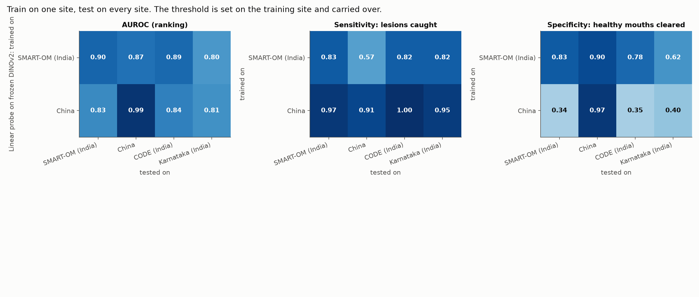

# Oral screen shift

Does a model that flags suspicious mouth lesions from phone photos still work when it is moved to a different hospital?

Oral cancer is common in South Asia and is usually found late, although early lesions can be seen in the mouth. Published models report accuracy above 90%, but each is tested on photos from the same source it was trained on. This project trains on one public dataset and tests on three others.

**Not a medical device.** Research code only.

## What it found

Results so far are for a linear probe on frozen DINOv2 features. Fine-tuned ResNet-50 results are being added. Full write-up: [REPORT.md](REPORT.md).



| Trained on | Tested on | AUROC | Lesions caught | Healthy mouths cleared |
|---|---|---|---|---|
| China | China | 0.99 | 91% | 97% |
| China | SMART-OM (India) | 0.83 | 97% | 34% |
| SMART-OM (India) | SMART-OM | 0.90 | 83% | 83% |
| SMART-OM (India) | China | 0.87 | 57% | 90% |
| SMART-OM (India) | CODE (same research network) | 0.89 | 82% | 78% |

1. A model's ranking of photos survives a move much better than its decisions do. AUROC drops a little. The threshold learned at one site fails at another: two of three healthy mouths flagged in one direction, almost half the lesions missed in the other.
2. Inside one research network, with one photo protocol, nothing is lost.
3. A statistical safety guarantee fails in the same way. A rule that promises 90% coverage delivers 7% to 67% at another group's site.
4. Fifty local labelled photos restore the promise, but the model then says "not sure" for most photos.
5. Photos carry a site signature. A simple classifier can tell which dataset a healthy photo came from with 91% to 99% accuracy.
6. The public datasets overlap. Ten photos are identical in two datasets with different labels, and all seven cancer photos of one dataset also sit in another. See [data/README.md](data/README.md).

## What is here

| Path | What it is |
|---|---|
| [REPORT.md](REPORT.md) | Question, data, method, results, limits |
| [WHY.md](WHY.md) | One entry per code file: why it exists |
| [data/README.md](data/README.md) | The datasets, their licences, what was found inside them |
| `src/` | Dataset indexing, patient-level splits, metrics, conformal refusal, models |
| `experiments/` | The four experiments and the script that trains the models |
| `results/` | Tables, figures and saved predictions |
| `splits/` | The train/validation/test split of every photo, three seeds |
| `notebooks/colab_gpu.ipynb` | Runs the training on a free Colab GPU |
| `app/demo.py` | Upload a photo, get "refer", "do not refer" or "not sure" |

## Run it

```bash
python -m venv .venv
.venv/Scripts/python -m pip install -r requirements.txt
.venv/Scripts/python -m pytest -q
```

On macOS or Linux use `.venv/bin/python`. The tests use small generated images and need no dataset, GPU or network. The full suite takes about eight minutes; add `--deselect tests/test_experiments.py` for the one-minute version.

Remake every table and figure from the saved predictions, with no dataset:

```bash
.venv/Scripts/python -m experiments.e1_matrix
.venv/Scripts/python -m experiments.e2_fixes
.venv/Scripts/python -m experiments.e3_refusal
```

Start from the raw photos (about 10 GB):

```bash
.venv/Scripts/python scripts/download.py --site smartom --out data
.venv/Scripts/python scripts/prepare.py --data data
.venv/Scripts/python -m experiments.run_gpu --data data --stage features
.venv/Scripts/python -m experiments.run_gpu --data data --stage probe
```

Repeat the first command for `china`, `code` and `karnataka`. The ResNet stages need a GPU; use the Colab notebook.

Demo, after the feature stage has run:

```bash
.venv/Scripts/streamlit run app/demo.py
```

## Data

No image is stored in this repository. `scripts/download.py` fetches each dataset from its owner. Credits and licences are in [data/README.md](data/README.md). A fifth dataset from Sri Lanka is restricted; the code can load it once its owner grants access, and nothing from it is published here.

## Licence

Code: MIT. The datasets keep their own licences.
