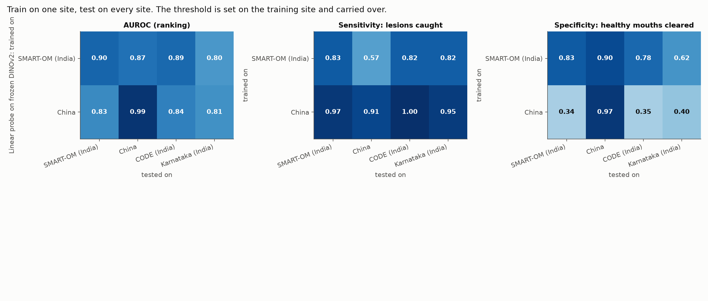
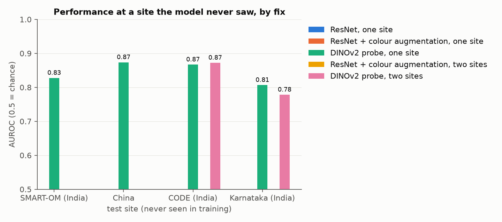
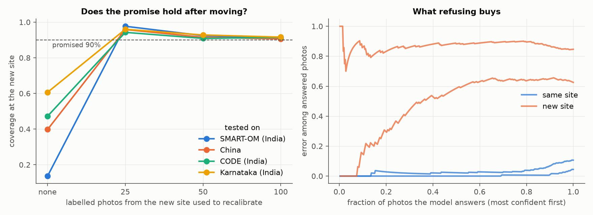

# Does an oral-lesion screening model survive a change of hospital?

Sachchidananda Behera, November 2026. Code: this repository.

The results below are for one of the two model families, a linear probe on frozen DINOv2 features. The fine-tuned ResNet-50 models are trained by `notebooks/colab_gpu.ipynb` and their rows will be added. A fifth dataset (Sri Lanka, restricted access) is approved but not yet included.

## Summary

Oral cancer is often found late, although early lesions can be seen in the mouth, so several groups have trained models to flag suspicious lesions from phone photos. Their papers report accuracy on photos from the same source the model was trained on. I trained on one public dataset and tested on three others.

1. A model's ranking of photos survives a move much better than its decisions do. A model trained on the China dataset scores AUROC 0.99 at home and 0.83 on SMART-OM (India). But with the threshold it learned at home, it clears only 34% of healthy Indian mouths, down from 97%. A model trained on SMART-OM catches 83% of lesions at home and 57% in the China dataset.
2. A move inside one research network costs nothing. SMART-OM to CODE (same network and photo protocol): AUROC 0.90 to 0.89, sensitivity 0.83 to 0.82.
3. A statistical safety guarantee fails in the same way. A conformal "answer or say not sure" rule promises the right answer is in its output 90% of the time. At home it delivers 89% to 92%. After a move to another research group's dataset it delivers between 7% and 67%.
4. Recalibrating on local photos makes the rule honest again, at the cost of answering few photos. With 100 labelled photos from the new site the 90% promise holds again, but outside its own research network the model then answers only 8% to 48% of photos and says "not sure" for the rest.
5. The photos carry a site signature. A linear classifier can tell which dataset a *healthy* photo came from with 91% to 99% balanced accuracy. Since the datasets differ enormously in how many lesions they contain (79% in China, 6% in SMART-OM), a model can do well at home by recognising the dataset.
6. The public datasets overlap. Ten photos are identical in the China and Karnataka datasets, with different labels. All seven oral cancer photos in CODE are also in SMART-OM. Any study that trains on one and tests on the other without checking is partly testing on its training data.

The published models may well be right about their own data. An in-site test still tells a clinic very little about what will happen in its own waiting room.

## Data

Four public datasets of mouth photos. Details, licences and file layouts are in `data/README.md`.

| Site | Country | Role | Photos | Refer photos | Patients or groups |
|---|---|---|---|---|---|
| SMART-OM | India | train and test | 2,469 | 145 (6%) | 331 |
| China | China | train and test | 1,348 | 1,062 (79%) | 1,307 |
| CODE | India | test only | 5,567 | 13 (0.2%) | 697 |
| Karnataka | India | test only | 313 | 148 (47%) | 313 |

Each dataset names its classes differently. Every class is mapped to the decision a screener makes: *refer* (a potentially malignant disorder or cancer) or *do not refer* (healthy, normal variation, benign).

Cleaning the data turned up four problems.

- CODE is described as a dataset spanning normal mucosa to oral cancer. Version 5 holds 5,431 normal photos, 166 normal variations, 14 potentially malignant and 7 cancer. It cannot train a model. It is kept as a test of false alarms on healthy mouths at an unseen centre.
- CODE and SMART-OM share 33 photos by image fingerprint, including all 7 of CODE's cancer photos. They were removed from CODE.
- China and Karnataka share 10 identical photos. China labels them leukoplakia or lichen planus; Karnataka labels them malignant. They were removed from Karnataka.
- Both SMART-OM and CODE ship copies of each photo with the lesion outline drawn on it. Only the clean copies are used.

The splits are 70/15/15 by patient within SMART-OM and China, three seeds, each a different split. Where a dataset gives no patient id, near-identical photos are grouped and kept together. CODE and Karnataka are test only.

## Method

The model is DINOv2 ViT-B/14 with frozen weights turns each photo into 768 numbers. A logistic regression on top is the only trained part. Its regularisation strength is chosen on the training site's validation split.

The decision threshold is chosen on the training site's validation split, as the highest value that still catches 90% of refer cases there, and is carried unchanged to every test site. No test-site label is used to set anything, except in the recalibration experiment, where it is the point.

The 95% intervals come from 1,000 bootstrap resamples of patients, not photos, for each seed; the ends are averaged over the three seeds.

The refusal rule is split conformal prediction with a 10% error target, calibrated on the training site's validation split. The model answers when exactly one class is plausible and says "not sure, refer" otherwise.

## Results

### Experiment 1: train on one site, test on all four



| Trained on | Tested on | AUROC | Sensitivity | Specificity | Calibration error |
|---|---|---|---|---|---|
| SMART-OM | SMART-OM | 0.90 (0.82 to 0.96) | 0.83 (0.67 to 0.95) | 0.83 (0.80 to 0.87) | 0.08 |
| SMART-OM | CODE | 0.89 (0.81 to 0.96) | 0.82 (0.67 to 1.00) | 0.78 (0.77 to 0.79) | 0.13 |
| SMART-OM | China | 0.87 (0.81 to 0.93) | 0.57 (0.49 to 0.64) | 0.90 (0.80 to 0.98) | 0.51 |
| SMART-OM | Karnataka | 0.80 (0.75 to 0.85) | 0.82 (0.76 to 0.88) | 0.62 (0.55 to 0.69) | 0.13 |
| China | China | 0.99 (0.98 to 1.00) | 0.91 (0.86 to 0.95) | 0.97 (0.92 to 1.00) | 0.03 |
| China | SMART-OM | 0.83 (0.74 to 0.90) | 0.97 (0.92 to 1.00) | 0.34 (0.28 to 0.39) | 0.79 |
| China | CODE | 0.84 (0.67 to 0.92) | 1.00 (1.00 to 1.00) | 0.35 (0.33 to 0.36) | 0.84 |
| China | Karnataka | 0.81 (0.77 to 0.86) | 0.95 (0.91 to 0.98) | 0.40 (0.33 to 0.48) | 0.39 |

AUROC falls by 0.03 to 0.18 after a move, a drop a reader might accept. Sensitivity and specificity change far more. The China-trained model's scores for healthy mouths rise from an average of 0.11 at home to 0.84 on SMART-OM, so nearly everything crosses the threshold. The SMART-OM-trained model's scores for lesions fall from 0.61 at home to 0.34 on China, so half slip under it. The calibration error column says the same thing: 0.03 at home, 0.79 away.

The exception is SMART-OM to CODE, which share a research network and a written photo protocol. Nothing is lost there. The shared photo protocol is the obvious candidate for why, though this study cannot isolate it.

Sensitivity on SMART-OM and CODE rests on about 21 and 13 refer photos. Their intervals are wide.

### Experiment 2: fixes



Only one fix can be judged so far: training on both SMART-OM and China, tested on the two sites neither has seen.

| Test site | Trained on | AUROC | Sensitivity | Specificity |
|---|---|---|---|---|
| CODE | one site (mean of two) | 0.87 | 0.91 | 0.56 |
| CODE | both sites | 0.87 | 0.62 | 0.86 |
| Karnataka | one site (mean of two) | 0.81 | 0.89 | 0.51 |
| Karnataka | both sites | 0.78 | 0.89 | 0.46 |

Pooling did not improve ranking at an unseen site, and on Karnataka it made it slightly worse. It shifted the balance between sensitivity and specificity without improving either site's ranking. Colour augmentation and the ResNet comparison need the fine-tuned models and are pending.

### Experiment 3: does "not sure" keep its promise?



Each cell is *coverage / share of photos answered*. Coverage should be 0.90.

| Trained on | Tested on | No recalibration | 25 local photos | 50 | 100 |
|---|---|---|---|---|---|
| SMART-OM | SMART-OM | 0.89 / 95% | 0.94 / 83% | 0.91 / 93% | 0.89 / 94% |
| SMART-OM | CODE | 0.88 / 94% | 0.94 / 86% | 0.90 / 92% | 0.91 / 94% |
| SMART-OM | China | 0.40 / 89% | 0.96 / 14% | 0.91 / 23% | 0.91 / 25% |
| SMART-OM | Karnataka | 0.67 / 89% | 0.95 / 28% | 0.93 / 41% | 0.91 / 48% |
| China | China | 0.92 / 93% | 0.97 / 89% | 0.92 / 93% | 0.91 / 92% |
| China | SMART-OM | 0.14 / 83% | 0.98 / 3% | 0.92 / 10% | 0.91 / 12% |
| China | CODE | 0.07 / 82% | 0.95 / 6% | 0.92 / 8% | 0.92 / 8% |
| China | Karnataka | 0.54 / 90% | 0.97 / 14% | 0.93 / 30% | 0.92 / 34% |

Without recalibration the rule keeps answering confidently, 82% to 90% of photos, while being wrong far more often than it promised. That is the dangerous case, because the tool still looks sure.

Fifty labelled local photos are enough to restore the promise at every site tested. What they cannot restore is the model's ability to separate the classes at that site, so outside the SMART-OM network the honest rule answers fewer than half the photos, and often fewer than a quarter. A clinic could use this directly: about fifty labelled local photos show quickly whether the tool is usable there, and for most of the moves tested here it would not be.

In the right-hand panel, at home, the more confident the model, the more often it is right. Away, error is high at every confidence level, and for the China-trained model the most confident answers are the worst ones.

### Experiment 4: can the features tell the datasets apart?

Using healthy photos only, so that lesions cannot give the answer away, a linear classifier was trained to say which of two datasets a photo came from. Patients were kept whole within a fold.

| Datasets | Balanced accuracy (0.5 is chance) |
|---|---|
| China vs CODE | 0.99 |
| China vs SMART-OM | 0.99 |
| China vs Karnataka | 0.96 |
| CODE vs Karnataka | 0.92 |
| Karnataka vs SMART-OM | 0.91 |
| CODE vs SMART-OM | 0.91 |

Every pair is easy to tell apart. This is the likely mechanism behind experiment 1. In the China dataset four photos in five show a lesion; in SMART-OM one in seventeen does. A model that partly learns "this looks like a China-dataset photo" is rewarded at home and misled everywhere else.

CODE and SMART-OM are also separable at 0.91, yet a model moved between them loses nothing. So a visible site signature is not enough to break a model. The signature has to line up with the label, and a large difference in case mix makes it do so.

## Limits

- Only one model family is reported so far. The fine-tuned ResNet-50 results are pending. The pattern may be milder or worse for a model that adapts all its weights.
- There are two training sites. They differ in country, cameras and case mix at once, and this study cannot say how much each contributes. The Sri Lanka dataset would give a third.
- Two datasets have few lesions. SMART-OM's test split has about 21 refer photos and CODE has 13.
- Refer cases are under-covered. The refusal rule's 90% is an average over all photos. Because healthy photos dominate, it is met while a third of SMART-OM's refer cases are still confidently cleared. Calibrating each class separately is the standard remedy and is not done here.
- China and Karnataka give no patient ids. Photos are grouped by image similarity, which catches re-saved copies but not two different photos of one person.
- Part of the China dataset comes from published papers, where lesions tend to be advanced and obvious. Its near-perfect home score partly reflects that.
- Photo similarity is a blunt tool. 25 of the 33 SMART-OM/CODE pairs are near matches, not exact ones, and some may be different photos. They were removed anyway.
- This is not a clinical study. It has no prospective data and no comparison with clinicians, and it relies on the diagnoses the dataset owners report.

## What I would do next

1. Add the fine-tuned models and the Sri Lanka dataset.
2. Calibrate the refusal rule per class, so the promise holds for lesions specifically.
3. Remove the site signature before training (for example by adversarially penalising a which-dataset classifier) and test whether the threshold then travels.
4. Train with case mix matched across sites, to separate the effect of case mix from the effect of cameras.

## Reproducing

```bash
python scripts/download.py --site smartom --out data      # and china, code, karnataka
python scripts/prepare.py --data data                     # index, duplicates, splits
python -m experiments.run_gpu --data data --stage features
python -m experiments.run_gpu --data data --stage probe
python -m experiments.e1_matrix
python -m experiments.e2_fixes
python -m experiments.e3_refusal
python -m experiments.e4_site
```

The saved predictions for the open datasets are in `results/preds/`, so the last four commands run without any dataset.

## Datasets

- Madan Kumar P.D., Ranganathan K., et al. *SMART-OM: a smartphone-based expert-annotated dataset of oral mucosa images.* figshare, 2026. doi:10.6084/m9.figshare.31341790
- Madan Kumar P.D., Ranganathan K., et al. *CODE: Comprehensive Oral mucosa Database with Explanations*, version 5. figshare, 2026. doi:10.6084/m9.figshare.30550889
- Yu J., Huang R., Wang X., et al. *A comparative study of single-stage and dual-stage classification models for OPMDs.* BMC Oral Health 26, 169 (2026). doi:10.1186/s12903-025-07582-y
- *Oral Images Dataset.* Mendeley Data, `mhjyrn35p4`, version 2.
- Oquab M., et al. *DINOv2: learning robust visual features without supervision.* 2023.
